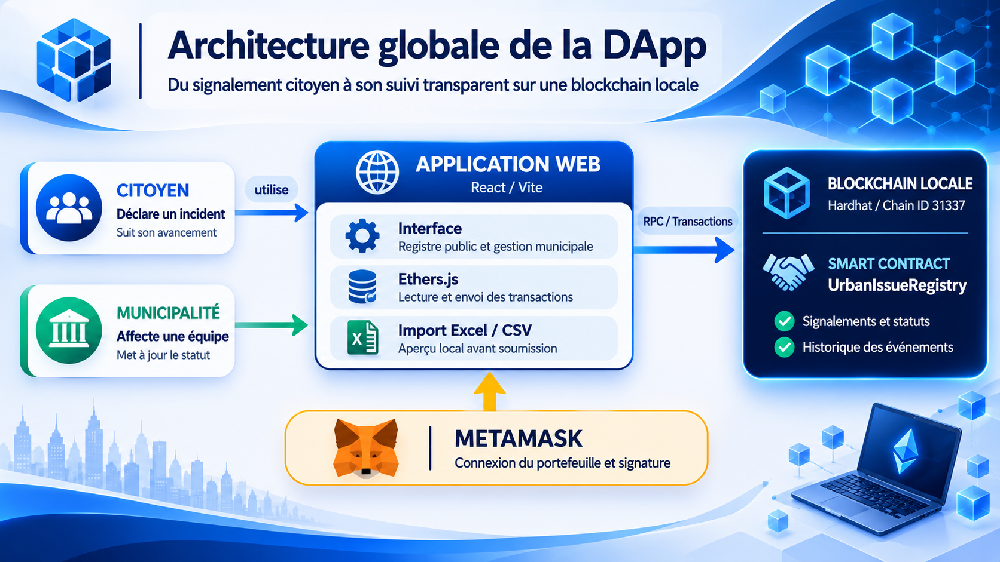
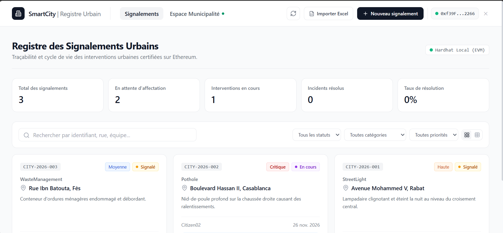
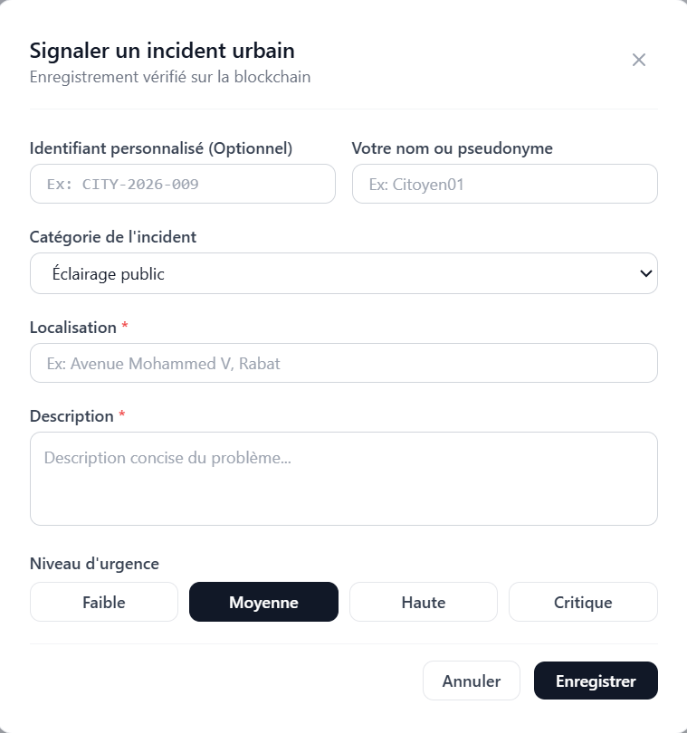
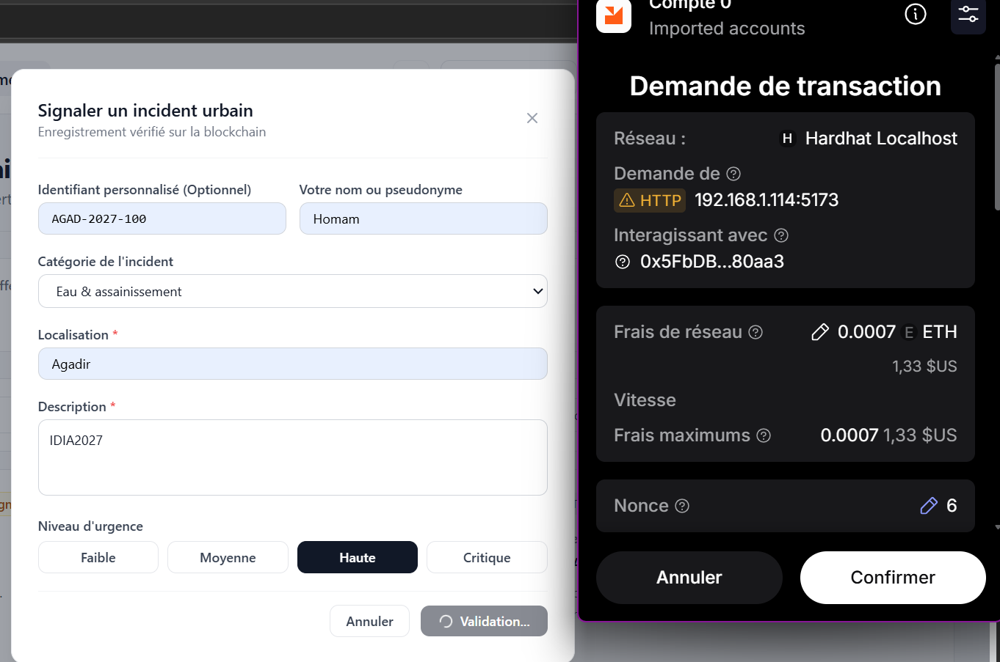
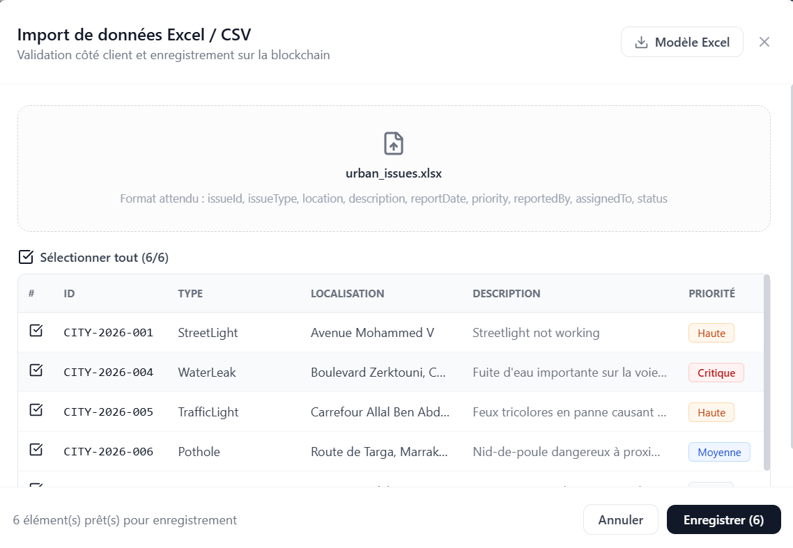
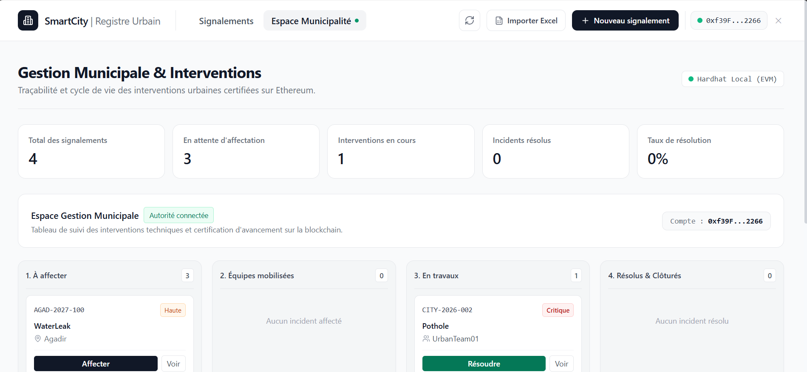
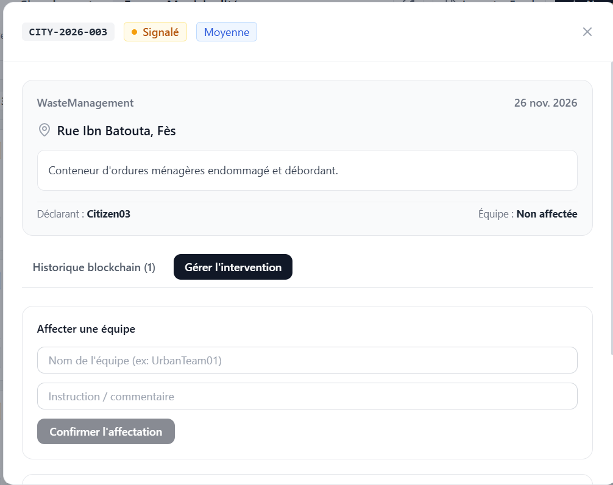
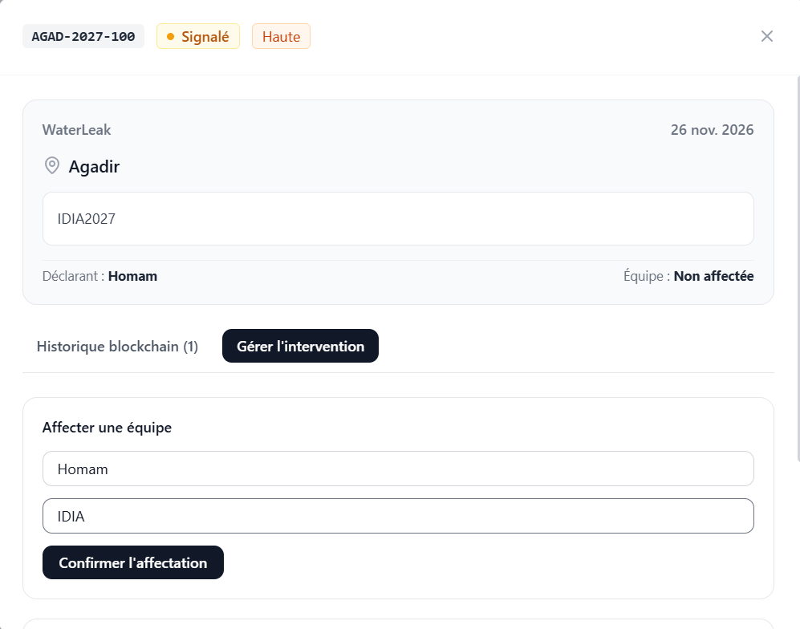
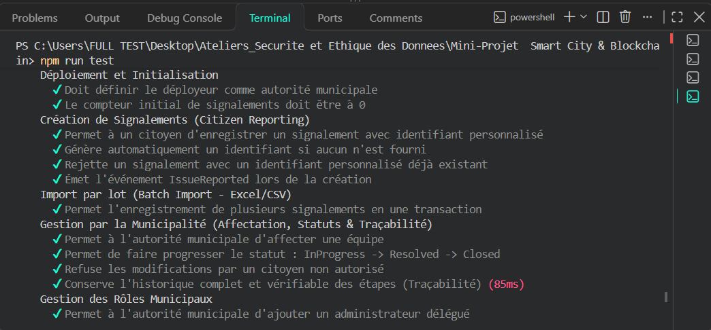
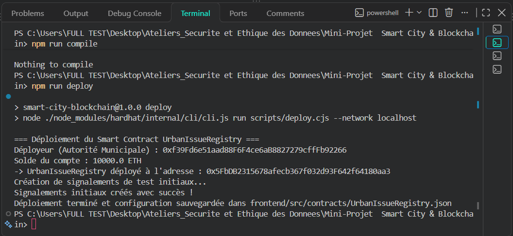

<div align="center">

<!-- ========================================== -->
<!-- EN-TÊTE & LOGOS ACADÉMIQUES -->
<!-- ========================================== -->
<table>
  <tr>
    <td align="center" width="50%" style="border: none;">
      <br/>
      <b>Université Abdelmalek Essaâdi</b><br/>
      <i>Tanger - Tétouan - Al Hoceïma</i>
    </td>
    <td align="center" width="50%" style="border: none;">
      <br/>
      <b>Faculté des Sciences et Techniques</b><br/>
      <i>Département d'Informatique</i>
    </td>
  </tr>
</table>

<br/>

---

### **FORMATION : SÉCURITÉ ET ÉTHIQUE DES DONNÉES**
#### **Module : Smart City, Blockchain & Sécurité Décentralisée**

---

<br/><br/>

# 🏙️ **RAPPORT DE MINI-PROJET**
## **Plateforme Décentralisée de Gestion des Services Urbains (Smart City & Blockchain)**

*Conception et Réalisation d'une DApp Ethereum avec Traçabilité Immuable, Smart Contract Solidity, Frontend React/Vite et Importation Massive Excel*

<br/><br/>

<table>
  <tr>
    <td width="50%" align="left" style="border: none;">
      <b>Réalisé par :</b><br/>
      🎓 <strong>Homam Dany</strong><br/>
      <i>Étudiant en Sécurité et Éthique des Données</i>
    </td>
    <td width="50%" align="right" style="border: none;">
      <b>Sous la direction de :</b><br/>
      👩‍🏫 <strong>Mme. Ikram Benabdelouahab</strong><br/>
      <i>Professeure & Encadrante du Module</i>
    </td>
  </tr>
</table>

<br/><br/>

### 🔗 **Ressources Numériques & Livrables :**
- **Vidéo de Démonstration (Google Drive) :** [Accéder à la Vidéo de Démonstration](https://drive.google.com/drive/u/1/folders/198ZK9E4waxVuCqASUDesGqoxp-_jRpSy)
- **Dépôt GitHub du Projet :** [Homam-Dany / Securite-et-Ethique-des-Donnees](https://github.com/Homam-Dany/Securite-et-Ethique-des-Donnees/tree/main)

<br/>

**Année Universitaire : 2026 – 2027**

<br/>

</div>

<div style="page-break-after: always;"></div>

---

## 📝 Résumé (Abstract)

Dans le contexte actuel de transformation numérique et d'essor des **Smart Cities**, l'optimisation des services publics locaux constitue un enjeu stratégique majeur. Les municipalités sont confrontées à des défis d'efficacité opérationnelle, de réactivité des équipes techniques et, surtout, de transparence vis-à-vis des administrés. Les systèmes de gestion urbaine conventionnels, basés sur des bases de données relationnelles centralisées, présentent des limites structurelles : risque de manipulation des enregistrements, opacité dans le traitement des réclamations et dépendance envers une autorité centrale.

Ce projet propose une réponse innovante à travers la conception et le déploiement d'une **Application Décentralisée (DApp)** fondée sur la technologie **Blockchain Ethereum**. En s'appuyant sur un Smart Contract robuste rédigé en **Solidity (`UrbanIssueRegistry`)**, la solution garantit un enregistrement infalsifiable du cycle de vie complet des incidents urbains (éclairage public, nids-de-poule, fuites d'eau, dépôts d'ordures, feux tricolores) : depuis leur signalement citoyen jusqu'à leur résolution et clôture administrative. Chaque intervention, affectation d'équipe ou note technique est archivée de manière immuable avec horodatage cryptographique et identification de l'acteur (`msg.sender`).

L'écosystème comprend également une interface web moderne développée en **React 18 + Vite** connectée au portefeuille **MetaMask**, intégrant un tableau de bord municipal et un module d'importation massive de données via tableur **Excel/CSV (SheetJS)** avec exécution groupée en une transaction atomique. L'ensemble du code a été validé par une suite de **14 tests unitaires automatisés** sous l'environnement **Hardhat**, garantissant sécurité, conformité éthique (RGPD) et résilience.

**Mots-clés :** *Blockchain, Ethereum, Smart Contracts, Solidity, Smart City, Traçabilité Immuable, Hardhat, Ethers.js, React, SheetJS, Éthique des Données.*

---

## 📋 Table des Matières

- [1. Introduction Générale](#1-introduction-générale)
  - [1.1 Contexte des Villes Intelligentes](#11-contexte-des-villes-intelligentes)
  - [1.2 Problématique de la Gestion Urbaine Conventionnelle](#12-problématique-de-la-gestion-urbaine-conventionnelle)
  - [1.3 Objectifs et Périmètre du Mini-Projet](#13-objectifs-et-périmètre-du-mini-projet)
- [2. Étude Préalable & Choix Technologiques](#2-étude-préalable--choix-technologiques)
  - [2.1 Pourquoi la Blockchain pour les Services Publics ?](#21-pourquoi-la-blockchain-pour-les-services-publics-)
  - [2.2 Comparatif : Base de Données Centralisée vs Blockchain Décentralisée](#22-comparatif--base-de-données-centralisée-vs-blockchain-décentralisée)
  - [2.3 Stack Technologique Retenue](#23-stack-technologique-retenue)
- [3. Analyse Fonctionnelle & Modélisation](#3-analyse-fonctionnelle--modélisation)
  - [3.1 Acteurs du Système](#31-acteurs-du-système)
  - [3.2 Cycle de Vie Opérationnel d'un Signalement](#32-cycle-de-vie-opérationnel-dun-signalement)
  - [3.3 Modèle de Données & Structure Excel](#33-modèle-de-données--structure-excel)
- [4. Conception & Implémentation du Smart Contract](#4-conception--implémentation-du-smart-contract)
  - [4.1 Architecture du Contrat UrbanIssueRegistry](#41-architecture-du-contrat-urbanissueregistry)
  - [4.2 Fonctions Métier Fondamentales](#42-fonctions-métier-fondamentales)
  - [4.3 Sécurité, Contrôle d'Accès et Protection des Données (RGPD)](#43-sécurité-contrôle-daccès-et-protection-des-données-rgpd)
- [5. Développement du Frontend Web3](#5-développement-du-frontend-web3)
  - [5.1 Interface Citoyenne & Signalement Décentralisé](#51-interface-citoyenne--signalement-décentralisé)
  - [5.2 Module d'Importation Massive de Données (Excel/CSV via SheetJS)](#52-module-dimportation-massive-de-données-excelcsv-via-sheetjs)
  - [5.3 Espace Municipalité & Dispatching](#53-espace-municipalité--dispatching)
  - [5.4 Consultation Publique & Timeline de Traçabilité](#54-consultation-publique--timeline-de-traçabilité)
- [6. Tests, Validation & Démonstration](#6-tests-validation--démonstration)
  - [6.1 Suite de Tests Unitaires Hardhat (14/14 tests)](#61-suite-de-tests-unitaires-hardhat-1414-tests)
  - [6.2 Déploiement sur Réseau Local](#62-déploiement-sur-réseau-local)
  - [6.3 Scénario de Démonstration Fonctionnelle](#63-scénario-de-démonstration-fonctionnelle)
  - [6.4 Vidéo Démonstrative (Lien Google Drive)](#64-vidéo-démonstrative-lien-google-drive)
- [7. Guide d'Installation et d'Utilisation](#7-guide-dinstallation-et-dutilisation)
- [8. Conclusion & Perspectives](#8-conclusion--perspectives)
- [Annexes : Catalogue des Captures d'Écran](#annexes--catalogue-des-captures-décran)

---

## 🖼️ Table des Figures

| Référence | Titre de la Figure | Emplacement Fichier Image |
| :--- | :--- | :--- |
| **Figure 1** | Schéma d'Architecture Globale de la DApp Smart City | `images/fig01_architecture_dapp.png` |
| **Figure 2** | Diagramme d'États du Cycle de Vie d'un Signalement | `images/fig02_cycle_de_vie.png` |
| **Figure 3** | Exécution et Validation des 14 Tests Unitaires Hardhat | `images/fig03_tests_unitaires.png` |
| **Figure 4** | Déploiement du Smart Contract et Enregistrement On-Chain | `images/fig04_deploiement_contrat.png` |
| **Figure 5** | Vue Principale du Registre Public des Incidents Urbains | `images/fig05_interface_accueil.png` |
| **Figure 6** | Formulaire Citoyen de Signalement d'un Dysfonctionnement | `images/fig06_formulaire_signalement.png` |
| **Figure 7** | Signature Cryptographique de la Transaction sur MetaMask | `images/fig07_signature_metamask.png` |
| **Figure 8** | Module d'Importation Excel Client-Side & Validation SheetJS | `images/fig08_import_excel.png` |
| **Figure 9** | Espace de Gestion et Tableau de Dispatching Municipal | `images/fig09_espace_municipalite.png` |
| **Figure 10** | Affectation d'une Équipe d'Intervention Technique | `images/fig10_affectation_equipe.png` |
| **Figure 11** | Journal Immuable et Timeline de Traçabilité Blockchain | `images/fig11_timeline_tracabilite.png` |

---

## 📊 Table des Tableaux

| Référence | Titre du Tableau |
| :--- | :--- |
| **Tableau 1** | Comparaison Architecturale : SGBD Relationnel vs Blockchain Ethereum |
| **Tableau 2** | Matrice des Droits d'Accès par Rôle (RBAC) |
| **Tableau 3** | Structure et Colonnes Conformes du Fichier `urban_issues.xlsx` |
| **Tableau 4** | Inventaire Détaillé des 14 Tests Unitaires Validés |

<div style="page-break-after: always;"></div>

---

# 1. Introduction Générale

## 1.1 Contexte des Villes Intelligentes
Les villes contemporaines font face à des défis démographiques, écologiques et infrastructurels sans précédent. Le concept de **Smart City** (ville intelligente) vise à mobiliser les technologies de l'information et de la communication (TIC) pour améliorer la qualité de vie des citoyens, optimiser l'allocation des ressources publiques et accroître la résilience des infrastructures municipales (réseaux d'éclairage, chaussées, réseaux de distribution d'eau potable, collecte des déchets).

## 1.2 Problématique de la Gestion Urbaine Conventionnelle
Actuellement, lorsqu'un citoyen constate une anomalie dans l'espace public (ex: lampadaire en panne, nid-de-poule dangereux sur une artère principale), le traitement repose sur des centres d'appels ou des portails web centralisés traditionnels. Cette approche souffre de lacunes critiques :
1. **Opacité du suivi :** L'usager ignore si sa déclaration a été prise en compte, affectée à un prestataire ou rejetée.
2. **Vulnérabilité des données :** Les bases de données centralisées (MySQL, PostgreSQL) permettent aux administrateurs de modifier ou supprimer rétroactivement des réclamations pour masquer des retards d'intervention.
3. **Absence d'auditabilité publique :** Les rapports de conformité ne disposent d'aucun mécanisme cryptographique prouvant leur authenticité temporelle.

## 1.3 Objectifs et Périmètre du Mini-Projet
L'objectif de ce mini-projet est de développer une **plateforme décentralisée (DApp)** complète répondant aux exigences suivantes :
- **Enregistrement immuable** de chaque signalement citoyen avec génération d'identifiant unique (`CITY-2026-XXX`).
- **Garantie de traçabilité** : conservation intégrale de l'historique des statuts, des équipes affectées, des commentaires de terrain et de l'adresse blockchain de chaque intervenant.
- **Importation massive** de signalements urbains depuis un tableur Excel (`urban_issues.xlsx`) exécutée de façon atomique sur la blockchain.
- **Contrôle d'accès rigoureux** : réservation des actions modificatrices aux comptes municipaux accrédités tout en maintenant une consultation publique ouverte à tous.

---

# 2. Étude Préalable & Choix Technologiques

## 2.1 Pourquoi la Blockchain pour les Services Publics ?
La blockchain apporte trois caractéristiques fondamentales à la gouvernance municipale :
- **Immuabilité (Tamper-proof) :** Tout enregistrement validé dans un bloc ne peut être altéré ni effacé.
- **Transparence Vérifiable :** N'importe quel citoyen peut auditer l'historique d'une intervention sans passer par un intermédiaire.
- **Désintermédiation et Confiance :** Les règles d'avancement des dossiers sont encodées dans le smart contract et s'exécutent de façon déterministe.

## 2.2 Comparatif : Base de Données Centralisée vs Blockchain Décentralisée

*Tableau 1 : Comparaison Architecturale*

| Critère | Système Centralisé Traditionnel | Solution Blockchain Ethereum (Notre DApp) |
| :--- | :--- | :--- |
| **Stockage** | Serveur SQL unique / Cloud propriétaire | Registre distribué répliqué sur les nœuds EVM |
| **Authentification** | Login / Mot de passe classique | Clés cryptographiques asymétriques (MetaMask) |
| **Modification d'historique** | Possible via requêtes `UPDATE` / `DELETE` | Impossible (écriture en append-only certifiée) |
| **Auditabilité** | Logs internes modifiables par l'admin | Événements Solidity indexés et interrogeables |
| **Résilience** | Point de défaillance unique (Single Point of Failure) | Tolérance aux pannes et intégrité distribuée |

## 2.3 Stack Technologique Retenue

<div align="center">
  
  <br/>
  <em>Figure 1 : Schéma d'Architecture Globale de la DApp Smart City</em>
</div>

- **Solidity (`^0.8.20`) :** Langage de programmation sécurisé pour le développement du smart contract, intégrant la gestion des types énumérés (`enum`), des structures (`struct`) et du contrôle d'accès.
- **Hardhat :** Environnement de développement Ethereum professionnel permettant la compilation, les tests automatisés avec Chai/Mocha et le déploiement sur nœud local.
- **React 18 + Vite :** Framework frontend performant offrant un rechargement à chaud ultra-rapide et un composant dynamique réactif.
- **Ethers.js v6 :** Bibliothèque client Web3 permettant d'instancier les providers (`BrowserProvider`), de signer les transactions via le `Signer` et de lire l'état du contrat.
- **SheetJS (`xlsx`) :** Librairie JavaScript permettant de parser côté client les fichiers Excel sans téléversement sur serveur distant.
- **MetaMask :** Extension de portefeuille non-custodial utilisée pour la gestion des clés privées et l'approbation cryptographique des transactions.

---

# 3. Analyse Fonctionnelle & Modélisation

## 3.1 Acteurs du Système
1. **Le Citoyen (Administré) :** Détecte une anomalie dans la cité, se connecte via son portefeuille Web3, soumet une déclaration géolocalisée et consulte publiquement l'avancement des travaux.
2. **L'Autorité Municipale (Gestionnaire) :** Compte habilité (`municipalAuthority` ou `municipalAdmins`) capable d'assigner les équipes techniques, de changer les statuts opérationnels et de clôturer les dossiers.
3. **L'Équipe d'Intervention Technique :** Brigade de voirie ou régie spécialisée mobilisée pour exécuter les réparations sur le terrain et transmettre ses rapports d'intervention.

## 3.2 Cycle de Vie Opérationnel d'un Signalement

<div align="center">
  
  <br/>
  <em>Figure 2 : Diagramme d'États du Cycle de Vie d'un Signalement</em>
</div>

Chaque incident suit strictement la séquence ordonnée suivante :
$$\text{Reported} \longrightarrow \text{Assigned} \longrightarrow \text{InProgress} \longrightarrow \text{Resolved} \longrightarrow \text{Closed}$$

1. **`Reported` (Signalé) :** Incident enregistré sur la blockchain par un citoyen ou par import Excel.
2. **`Assigned` (Affecté) :** L'autorité municipale désigne une équipe d'intervention technique dédiée.
3. **`InProgress` (En cours) :** Les ouvriers sont sur site et réalisent les travaux de réfection.
4. **`Resolved` (Résolu) :** L'incident technique est réparé et testé avec succès.
5. **`Closed` (Clôturé) :** Contrôle de qualité administratif validé et archivage définitif.

## 3.3 Modèle de Données & Structure Excel
Conformément aux directives de la Section 5 du cahier des charges, le fichier de test `urban_issues.xlsx` respecte scrupuleusement les 9 colonnes standardisées :

*Tableau 3 : Structure et Colonnes Conformes du Fichier `urban_issues.xlsx`*

| Colonne | Type | Exemple | Description |
| :--- | :--- | :--- | :--- |
| **`issueId`** | String | `CITY-2026-004` | Identifiant textuel unique de l'incident |
| **`issueType`** | String | `StreetLight` | Catégorie technique du dysfonctionnement |
| **`location`** | String | `Avenue Mohammed V, Rabat` | Adresse ou géolocalisation précise |
| **`description`** | String | `Lampadaire clignotant et éteint la nuit` | Description détaillée du problème |
| **`reportDate`** | String | `2026-11-19` | Date de constatation |
| **`priority`** | String | `High` | Niveau de gravité (`Low`, `Medium`, `High`, `Critical`) |
| **`reportedBy`** | String | `Citizen04` | Pseudonyme ou identifiant du déclarant |
| **`assignedTo`** | String | `UrbanTeam01` | Équipe d'intervention désignée |
| **`status`** | String | `Reported` | Statut initial du cycle de vie |

---

# 4. Conception & Implémentation du Smart Contract

## 4.1 Architecture du Contrat UrbanIssueRegistry
Le contrat `UrbanIssueRegistry.sol` est le cœur décentralisé de la plateforme. Il encapsule la structure d'état suivante :

```solidity
enum Priority { Low, Medium, High, Critical }
enum Status { Reported, Assigned, InProgress, Resolved, Closed }

struct HistoryEntry {
    uint256 timestamp;
    Status status;
    string assignedTeam;
    string comment;
    address actor;
}

struct Issue {
    uint256 id;
    string customId;
    string issueType;
    string location;
    string description;
    Priority priority;
    Status status;
    string reportedByName;
    address reporter;
    string assignedTeam;
    uint256 createdAt;
    uint256 updatedAt;
    bool exists;
}
```

## 4.2 Fonctions Métier Fondamentales
- **`reportIssue(...)` :** Permet à tout citoyen d'enregistrer un problème urbain. Le contrat alloue un identifiant numérique interne, valide l'unicité de l'identifiant personnalisé `customId`, initialise l'historique et émet l'événement `IssueReported`.
- **`batchReportIssues(...)` :** Fonction optimisée en gaz permettant de soumettre une liste de signalements issus d'un import Excel en une seule transaction. Si un identifiant existe déjà, le contrat le désambiguïse automatiquement en lui concaténant son numéro séquentiel unique, évitant ainsi le rejet de l'import.
- **`assignTeam(uint256 id, string team, string comment)` :** Affecte une équipe technique et fait basculer automatiquement le statut vers `Assigned` si l'état était `Reported`.
- **`updateStatus(uint256 id, Status newStatus, string comment)` :** Met à jour l'état opérationnel et consigne un nouvel enregistrement d'audit.
- **`getIssueHistory(uint256 id)` :** Retourne le tableau dynamique complet des entrées de traçabilité (`HistoryEntry[]`) pour consultation publique.

## 4.3 Sécurité, Contrôle d'Accès et Protection des Données (RGPD)

*Tableau 2 : Matrice des Droits d'Accès par Rôle (RBAC)*

| Opération | Citoyen (Tout Compte) | Autorité Municipale (`onlyMunicipality`) |
| :--- | :---: | :---: |
| Déclarer un signalement (`reportIssue`) | ✅ | ✅ |
| Importation massive (`batchReportIssues`) | ✅ | ✅ |
| Consultation publique (`getAllIssues`, `getIssueHistory`) | ✅ | ✅ |
| Affecter une équipe technique (`assignTeam`) | ❌ Refusé | ✅ Autorisé |
| Faire progresser le statut (`updateStatus`) | ❌ Refusé | ✅ Autorisé |
| Déléguer un rôle administrateur | ❌ Refusé | ✅ Autorisé |

> **Conformité Éthique & RGPD :**  
> Conformément aux recommandations de l'atelier, aucune donnée personnelle sensible (numéro de téléphone, adresse postale privée, identifiant national) n'est stockée sur la blockchain. Seuls des pseudonymes (`Citizen01`) et des coordonnées publiques d'infrastructure urbaine sont persistés.

---

# 5. Développement du Frontend Web3

L'interface utilisateur a été conçue selon une approche minimaliste, professionnelle et ergonomique (Clean SaaS), bannissant toute surcharge visuelle pour privilégier la lisibilité et l'efficacité opérationnelle.

## 5.1 Interface Citoyenne & Signalement Décentralisé

<div align="center">
  
  <br/>
  <em>Figure 5 : Vue Principale du Registre Public des Incidents Urbains</em>
</div>

<div align="center">
  
  <br/>
  <em>Figure 6 : Formulaire Citoyen de Signalement d'un Dysfonctionnement</em>
</div>

Le citoyen dispose d'un formulaire intuitif lui permettant de choisir la catégorie de l'incident, de saisir l'adresse précise, de décrire l'anomalie et d'estimer la priorité. Lors de la soumission, MetaMask sollicite la signature de l'utilisateur :

<div align="center">
  
  <br/>
  <em>Figure 7 : Signature Cryptographique de la Transaction sur MetaMask</em>
</div>

## 5.2 Module d'Importation Massive de Données (Excel/CSV via SheetJS)

<div align="center">
  
  <br/>
  <em>Figure 8 : Module d'Importation Excel Client-Side & Validation SheetJS</em>
</div>

Le composant d'importation permet de charger directement un fichier `.xlsx` ou `.csv`. Les données sont analysées dans le navigateur grâce à **SheetJS** sans transiter par un serveur tiers. Le système valide la complétude des colonnes, affiche un tableau de prévisualisation avec cases à cocher et permet d'exécuter un enregistrement groupé en un seul clic.

## 5.3 Espace Municipalité & Dispatching

<div align="center">
  
  <br/>
  <em>Figure 9 : Espace de Gestion et Tableau de Dispatching Municipal</em>
</div>

<div align="center">
  
  <br/>
  <em>Figure 10 : Affectation d'une Équipe d'Intervention Technique</em>
</div>

Réservé au compte autorité (`0xf39Fd...`), cet espace organise les dossiers sous forme de colonnes opérationnelles (*À affecter*, *Équipes mobilisées*, *En travaux*, *Résolus*). L'agent peut affecter une brigade en quelques secondes et valider les étapes d'avancement.

## 5.4 Consultation Publique & Timeline de Traçabilité

<div align="center">
  
  <br/>
  <em>Figure 11 : Journal Immuable et Timeline de Traçabilité Blockchain</em>
</div>

Chaque fiche de signalement intègre une timeline chronologique détaillant chaque événement certifié : horodatage à la seconde près, identité publique du signataire (`actor`), rapport d'avancement et état du dossier.

---

# 6. Tests, Validation & Démonstration

## 6.1 Suite de Tests Unitaires Hardhat (14/14 tests)

<div align="center">
  
  <br/>
  <em>Figure 3 : Exécution et Validation des 14 Tests Unitaires Hardhat</em>
</div>

*Tableau 4 : Inventaire Détaillé des 14 Tests Unitaires Validés*

| # | Domaine Testé | Comportement Attendu et Vérifié | Résultat |
| :---: | :--- | :--- | :---: |
| **1** | Déploiement | Vérifie que le déployeur est l'autorité municipale initiale | ✅ Validé |
| **2** | Déploiement | Vérifie que le compteur de signalements démarre à 0 | ✅ Validé |
| **3** | Signalement Citoyen | Enregistrement d'un incident avec ID personnalisé conforme | ✅ Validé |
| **4** | Signalement Citoyen | Auto-génération de l'ID (`CITY-2026-X`) si champ vide | ✅ Validé |
| **5** | Signalement Citoyen | Rejet strict en cas d'identifiant personnalisé déjà existant | ✅ Validé |
| **6** | Événements | Émission de l'événement `IssueReported` avec arguments indexés | ✅ Validé |
| **7** | Import par Lot | Enregistrement multiple en une transaction (`batchReportIssues`) | ✅ Validé |
| **8** | Gestion Municipale | Affectation d'équipe par l'autorité municipale | ✅ Validé |
| **9** | Gestion Municipale | Progression séquentielle du cycle de vie jusqu'à `Closed` | ✅ Validé |
| **10** | Contrôle d'Accès | Blocage des modifications tentées par un citoyen non accrédité | ✅ Validé |
| **11** | Traçabilité | Vérification de l'intégrité de l'historique et des 5 étapes consécutives | ✅ Validé |
| **12** | Administration | Ajout d'un administrateur municipal délégué | ✅ Validé |
| **13** | Administration | Transfert officiel de l'autorité municipale vers un tiers | ✅ Validé |
| **14** | Consultation | `getAllIssues` retourne la totalité des données à l'interface | ✅ Validé |

## 6.2 Déploiement sur Réseau Local

<div align="center">
  
  <br/>
  <em>Figure 4 : Déploiement du Smart Contract et Enregistrement On-Chain</em>
</div>

- **Adresse du contrat déployé :** `0x5FbDB2315678afecb367f032d93F642f64180aa3`
- **Compte Déployeur / Autorité Municipale :** `0xf39Fd6e51aad88F6F4ce6aB8827279cffFb92266`

## 6.3 Scénario de Démonstration Fonctionnelle
Le scénario d'évaluation s'articule comme suit :
1. **Émission d'un signalement** pour panne d'éclairage sur l'Avenue Mohammed V.
2. **Importation Excel** d'une flotte de 6 pannes urbaines depuis `urban_issues.xlsx`.
3. **Prise en charge municipale** : affectation de l'équipe `UrbanTeam01` et passage en état `InProgress`.
4. **Finalisation** : résolution de l'incident et consultation du journal de traçabilité infalsifiable.

## 6.4 Vidéo Démonstrative (Lien Google Drive)
L'intégralité du fonctionnement de la solution (déploiement, tests, interactions MetaMask, import Excel et traçabilité) a été enregistrée en démonstration vidéo :
👉 **[Lien du Dossier Google Drive de la Démonstration Vidéo](https://drive.google.com/drive/u/1/folders/198ZK9E4waxVuCqASUDesGqoxp-_jRpSy)**

---

# 7. Guide d'Installation et d'Utilisation

### Prérequis
- Node.js (version 18 ou supérieure)
- Extension navigateur MetaMask

### Procédure en 3 Terminaux

1. **Terminal 1 : Démarrage du Nœud Local Blockchain**
   ```powershell
   npm run node
   ```
2. **Terminal 2 : Déploiement du Smart Contract & Données Initiales**
   ```powershell
   npm run deploy
   ```
3. **Terminal 3 : Lancement de l'Application Web**
   ```powershell
   cd frontend
   npm run dev
   ```
Accédez ensuite à l'application via l'URL : **`http://localhost:5173`**.

---

# 8. Conclusion & Perspectives

Le présent mini-projet a permis de concevoir et de réaliser avec succès une plateforme décentralisée complète pour la gestion des services d'une Smart City. En combinant la robustesse du protocole **Ethereum**, l'immuabilité des **Smart Contracts Solidity**, et la réactivité d'une interface **React/Vite**, la solution résout les problèmes d'opacité et de défiance inhérents aux systèmes de gestion urbaine conventionnels.

### Perspectives d'Évolution :
- **Intégration d'IPFS (InterPlanetary File System) :** Permettre le stockage décentralisé de photos géolocalisées des dégâts avant et après travaux.
- **Micro-récompenses Citoyennes (Tokenisation ERC-20) :** Gratifier les citoyens signalant des anomalies avérées par des jetons municipaux échangeables contre des services urbains (transports en commun, accès aux infrastructures sportives).
- **Déploiement sur Layer 2 (Polygon / Arbitrum) :** Réduire drastiquement les coûts de gaz et accélérer le débit de validation des transactions pour un passage à l'échelle métropolitaine.

---

# Annexes : Catalogue des Captures d'Écran

Pour insérer vos captures d'écran dans le rapport, déposez vos fichiers dans le répertoire **`images/`** en respectant la nomenclature suivante :

| Nom du Fichier à Enregistrer | Description Précise de la Capture d'Écran |
| :--- | :--- |
| **`logo_uae.png`** | Logo officiel de l'Université Abdelmalek Essaâdi |
| **`logo_fst.png`** | Logo officiel de la Faculté des Sciences et Techniques de Tanger |
| **`fig01_architecture_dapp.png`** | Schéma d'architecture système DApp / Blockchain / Web3 |
| **`fig02_cycle_de_vie.png`** | Schéma du cycle de vie (Reported ➔ Assigned ➔ InProgress ➔ Resolved ➔ Closed) |
| **`fig03_tests_unitaires.png`** | Capture de la commande `npm run test` affichant 14 tests réussis |
| **`fig04_deploiement_contrat.png`** | Capture du terminal exécutant `npm run deploy` avec l'adresse du contrat |
| **`fig05_interface_accueil.png`** | Capture d'écran du Registre Public des Signalements |
| **`fig06_formulaire_signalement.png`** | Capture du formulaire de signalement citoyen ouvert |
| **`fig07_signature_metamask.png`** | Capture de la fenêtre MetaMask demandant la confirmation de transaction |
| **`fig08_import_excel.png`** | Capture de la modale d'importation Excel avec la table de prévisualisation |
| **`fig09_espace_municipalite.png`** | Capture de l'onglet Espace Municipalité avec les colonnes de gestion |
| **`fig10_affectation_equipe.png`** | Capture de la modale d'affectation d'une équipe technique |
| **`fig11_timeline_tracabilite.png`** | Capture de la timeline de traçabilité montrant les étapes et adresses blockchain |
